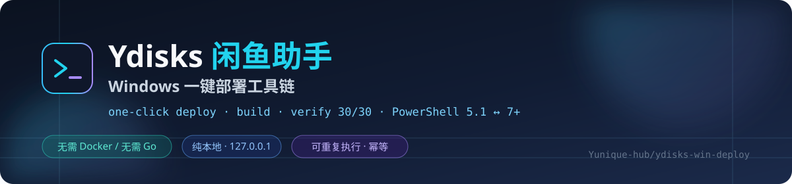

<div align="center">



# Ydisks 闲鱼助手 · Windows 一键部署工具链

**把 Go + React 的闲鱼多账号自动发货系统，在干净的 Windows 机器上从零跑起来 —— 双击一次，10–20 分钟后可用。**

[](https://github.com/Yunique-hub/ydisks-win-deploy/actions/workflows/ci.yml)
[](https://github.com/Yunique-hub/ydisks-win-deploy/releases)
[](LICENSE)
[](#兼容矩阵)
[](#兼容矩阵)
[](docs/04-验证报告.md)
[](tests/test_scripts.ps1)
[](tests/test_common_selftest.ps1)

[快速开始](#快速开始) · [它解决什么](#它解决什么) · [架构](#架构) · [命令速查](#命令速查) · [验证证据](#验证证据) · [排错](#排错) · [文档](#文档)

</div>

---

## 快速开始

```powershell
git clone https://github.com/Yunique-hub/ydisks-win-deploy.git
cd ydisks-win-deploy
.\一键部署.bat
```

或者用纯 ASCII 名的等价入口（脚本能力完全一致，只是文件名不会有中文）：

```powershell
.\deploy\bootstrap.ps1          # 也可以直接调 PowerShell 脚本
```

部署完成会打印管理后台地址与管理员账号，浏览器打开 **<http://127.0.0.1:59188>** 即可。

| 前置条件 | 说明 |
|---|---|
| Windows 10/11 x64 | 已实测 Windows Server 系亦可 |
| **Node.js 24+** | [下载](https://nodejs.org/)，构建前端用 |
| Git | [下载](https://git-scm.com/download/win)，拉上游源码用 |
| 磁盘 ≥ 3 GB | Go 工具链 72 MB + Chromium 约 690 MB + 依赖 |
| Go | **不需要** —— 脚本自动下载便携版到 `runtime\go`，用完即走 |
| PowerShell | **不需要额外装** —— 系统自带的 5.1 就能跑，装了 7 会自动优先用 |

---

## 它解决什么

上游 [Christ9038/Ydisks-Xianyu-Helper](https://github.com/Christ9038/Ydisks-Xianyu-Helper)
本身工程化程度很高，但它的部署文档假设你熟悉 Go / Docker / Linux。
在 Windows 单机上「照着文档做」会连续撞坑，而且每个坑的报错都指向错误方向。

本仓库把这些坑逐个钉死，并把**每一个的复现与修复证据**留在仓库里：

| # | 坑（真实踩过） | 表象 | 处理方式 |
|---|---|---|---|
| 1 | **`.ps1` 存成「无 BOM 的 UTF-8」** | 简体中文 Windows 上 PowerShell 5.1 按 GBK 解码源码，中文串被撕裂 → 报 `Missing closing '}'`、`Unexpected token ')'` 这类**和真实问题毫无关系**的语法错 | 全部脚本落 UTF-8 **BOM**，并把「含非 ASCII 必须带 BOM」做成静态门禁 + CI 门禁 |
| 2 | `npm` 在 PATH 里是 `npm.ps1` | `Start-Process` 报「不是有效的 Win32 应用程序」 | `Resolve-ExternalPath` 统一按 `exe → cmd → bat` 挑可执行兄弟文件 |
| 3 | `-ArgumentList` 不给参数加引号 | `-ldflags "-s -w"` 被拆开，`go build` 报 `flag provided but not defined: -w` | `ConvertTo-ArgumentString` 按 Windows 命令行规则补引号并转义 |
| 4 | `$args` 是 PowerShell 自动变量 | 赋值时抛 `Cannot overwrite variable args because it is read-only or constant` | 全部改名（`$buildArgs` / `$serverArgs` / `$requestArgs`），并加静态检查 |
| 5 | 5.1 不支持内联 `if` 表达式 | `status.ps1` 报 `The term 'if' is not recognized` | 先落变量再传参；静态检查禁止 `(if ...)` 出现在参数位 |
| 6 | 运行中的 exe 无法被覆盖 | 重建「成功」但产物是旧的，还多一个 `.exe~` 垃圾文件 | 构建前自动停服务、构建后自动恢复，并清理历史临时产物 |
| 7 | 版本变量不在 `main` 包 | 写成 `-X main.commit` 静默无效，版本永远显示 `dev` | 注入到 `xianyu-go/internal/version` 包，并在验证里断言不是 `dev` |
| 8 | `Start-Process -Wait` 等整棵进程树 | Chromium 留后台子进程 → 脚本卡住不返回 | 统一用带超时的 `Invoke-External`，超时用 `taskkill /T /F` 杀整棵树 |
| 9 | **重定向会把长驻进程的输出句柄继承给调用方** | 服务起来了，脚本却永远等不到 EOF → 调用方（CI / 编排器 / IDE 任务）像卡死 | 启动服务时**不用** `-RedirectStandardOutput`，实测 2.5 秒返回；服务自身写 `logs\server.log` |
| 10 | 上游冒烟工具用 `syscall.SIGTERM` | Windows 没有 POSIX 信号 → `make smoke` 必然失败 | 用 `deploy\verify.ps1`（30 项）替代 |

> 第 1 条是**最坑的一条**：报错信息完全指向错误方向，且只在简体中文 Windows 上出现
> （英文 Windows 的 ANSI 代码页是 1252，表现又不一样）。完整复盘见
> [docs/02-部署手册.md#编码坑复盘](docs/02-部署手册.md)。

---

## 架构

```
┌──────────────────────────────────────────────────────────────────────────────┐
│  入口层（双击可用）                                                            │
│  一键部署.bat  启动.bat  停止.bat  状态.bat  验证部署.bat  打开后台.bat          │
│         │  ASCII-only + CRLF：cmd 对非 ASCII 批处理的解析不可靠                 │
│         ▼                                                                     │
│  引导层  deploy/run.ps1                                                       │
│         · 优先 pwsh（PS7）→ 没有就回退 powershell.exe（5.1，无需安装）           │
│         · 控制台输出固定 UTF-8（5.1 默认按 ANSI 输出，中文会变 '?'）             │
│         · 透传退出码；-Elevate 走 UAC 提权（装 Windows 服务用）                  │
│         ▼                                                                     │
│  公共层  deploy/common.ps1                                                    │
│         · 目录布局 / 日志 / 外部命令封装 / 引号规则 / 端口与健康探测             │
│         ▼                                                                     │
│  作业层  bootstrap → build → start/stop/status/verify → reset-admin           │
│         · 每个脚本都可重复执行；状态探测优先于猜测                              │
│         ▼                                                                     │
│  产物层  runtime\bin\xianyu-server.exe / xianyu-tray.exe / browser-install.exe │
│         · 版本号+提交号注入；前端经 //go:embed 编进二进制                       │
└──────────────────────────────────────────────────────────────────────────────┘
```

### 兼容矩阵

| 运行环境 | 支持 | 说明 |
|---|---|---|
| Windows PowerShell 5.1（系统自带） | ✅ | **基线**。所有 `.ps1` 保持 5.1 语法兼容，`.bat` 默认走它 |
| PowerShell 7.x | ✅ | `.bat` 检测到 `pwsh` 会自动优先使用；CI 双版本矩阵跑同一套测试 |
| 无 BOM 的 UTF-8 脚本 | ❌ | 被静态检查与 CI 明确拦下（第 1 号坑） |
| Linux / macOS | ⚠️ | 脚本本身是 Windows 专用（服务管理、SCM、端口探测）。CI 的命令行部分是 Linux 友好的 |
| Docker | ✅ | 上游原生支持，见上游仓库；本仓库定位是「不用 Docker 的那条路」 |

---

## 命令速查

```powershell
# ---- 部署与构建 ----
.\deploy\bootstrap.ps1                     # 九阶段一键部署
.\deploy\bootstrap.ps1 -SkipBrowser        # 不装 Chromium（省约 690 MB）
.\deploy\bootstrap.ps1 -NoStart            # 只部署不启动
.\deploy\bootstrap.ps1 -Force              # 强制重新下载 Go / 重新克隆源码
.\deploy\build.ps1                         # 重新构建（自动停/起服务）
.\deploy\build.ps1 -SkipFrontend           # 只重建 Go（前端没改时更快）

# ---- 日常 ----
.\deploy\start.ps1                         # 启动 + 健康检查
.\deploy\start.ps1 -Foreground             # 前台启动，直接看报错
.\deploy\start.ps1 -Port 8080              # 换端口
.\deploy\stop.ps1                          # 三级退让停止（标记 → 关窗 → 强杀）
.\deploy\status.ps1                        # 状态总览
.\deploy\status.ps1 -Json                  # 状态（JSON，给脚本消费）

# ---- 验证与运维 ----
.\deploy\verify.ps1 -Password '<密码>'      # 30 项 / 八层完整验证
.\deploy\verify.ps1 -Password '<密码>' -SkipRestart   # 不中断正在使用的服务
.\deploy\verify.ps1 -Json                  # 机器可读结果
.\deploy\reset-admin.ps1                   # 重置管理员密码（自动停机/恢复）
.\deploy\install-service.ps1 -Mode install # 注册成 Windows 服务（需管理员）
.\deploy\install-service.ps1 -Mode status

# ---- 测试（本地就能跑，不需要已部署）----
.\tests\test_scripts.ps1                   # 20 项脚本静态检查（含 5.1 真实解析器）
.\tests\test_common_selftest.ps1           # 17 项公共层单元自测
```

---

## 验证证据

### 部署完整性：30 项 / 八层

`deploy\verify.ps1` 的判据刻意做得「苛刻」——避免出现「进程起来了就算成功」这种假通过：

| 层 | 内容 | 结果 |
|---|---|---|
| A 产物层 | 3 个 exe、版本已注入、Chromium 运行时、Playwright driver | 6/6 |
| B 进程层 | 进程、端口、PID 文件一致性 | 3/3 |
| C HTTP 层 | `/health`、SPA 首页、**10 个静态资源逐个真实命中**、深链回退 | 5/5 |
| D 鉴权层 | 未登录 401、已初始化、错误密码 401 | 3/3 |
| E 业务层 | 管理员登录、**20 个核心只读接口全部 200 JSON**、登出 | 3/3 |
| F 数据层 | SQLite 文件头、加密密钥、上传目录 | 4/4 |
| G 浏览器层 | 服务内 Playwright 就绪、**真实 Chromium 无头渲染 SPA** | 3/3 |
| H 收尾 | 优雅停止、端口释放、重新启动 | 3/3 |

```text
结论：全部通过    通过 30 / 跳过 0 / 失败 0 / 共 30
```

两个**刻意严格**的判据（普通检查会放过）：

1. 静态资源挂在 `/static/assets/` 下。按 `/assets/xxx` 请求会落进 SPA 回退 ——
   服务返回 **index.html 且状态码 200**，只看状态码会把失败判成成功。
   所以额外断言「返回体不是 index.html」。
2. 浏览器层不只看 HTTP 200，而是用真实 Chromium **无头渲染**，
   断言 React 挂载点非空、出现界面文案、且引用了静态资源。

### 脚本自身：20 项静态检查 + 17 项单元自测

```text
tests\test_scripts.ps1        检查结论：通过 20 / 失败 0 / 共 20
tests\test_common_selftest.ps1 自测结论：通过 17 / 失败 0 / 共 17
```

静态检查里有三条是**专门为本次事故加的**护栏：

* `.ps1 含非 ASCII 时带 UTF-8 BOM` —— 第 1 号坑不再可能悄悄回归
* `没有给自动变量赋值（$args / $input / $host ...）` —— 第 4 号坑
* `没有内联 if 表达式当参数（PS7 专属）` —— 第 5 号坑
* 外加「用**真实的 PowerShell 5.1 解析器**再解析一遍」—— 只用 PS7 的 Parser
  永远发现不了编码类问题（PS7 能读无 BOM 的 UTF-8）

证据留档与复现步骤：[docs/04-验证报告.md](docs/04-验证报告.md)

---

## 目录结构

```text
.
├── 一键部署.bat / 启动.bat / 停止.bat / 状态.bat / 验证部署.bat / 打开后台.bat
├── 安装服务.bat                  注册/卸载 Windows 服务（自动 UAC 提权）
│
├── deploy/                       ★ 部署与运维脚本
│   ├── common.ps1                公共层：路径、日志、外部命令封装、引号规则、探测函数
│   ├── run.ps1                   统一启动器：挑解释器 / UTF-8 控制台 / 提权 / 透传退出码
│   ├── bootstrap.ps1             从零部署（九阶段，可重复执行）
│   ├── build.ps1                 构建：前端 → Go 二进制（自动停/起服务）
│   ├── start.ps1                 启动 + 健康检查（后台进程）
│   ├── stop.ps1                  优雅停止（停止标记 → 关闭窗口 → 强杀）
│   ├── status.ps1                状态总览（含 -Json）
│   ├── verify.ps1                部署完整验证（30 项 / 八层）
│   ├── reset-admin.ps1           重置管理员密码
│   └── install-service.ps1       注册为 Windows 服务
│
├── tests/
│   ├── test_scripts.ps1          脚本静态检查（20 项，含真实 5.1 解析器门禁）
│   └── test_common_selftest.ps1  公共层单元自测（17 项）
│
├── docs/
│   ├── 01-项目分析.md             上游项目的代码级分析
│   ├── 02-部署手册.md             部署、配置、构建、编码坑复盘、排错表
│   ├── 03-使用说明.md             面向使用者的日常操作指南
│   └── 04-验证报告.md             全部验证的真实执行输出与证据
│
├── .github/workflows/ci.yml     CI：双 PowerShell 版本矩阵 + 静态检查 + 单元自测
├── CHANGELOG.md / SECURITY.md / CONTRIBUTING.md / CODE_OF_CONDUCT.md / NOTICE
│
├── app/                         上游源码（由 bootstrap 克隆，不入库）
├── runtime/                     工具链与产物（由 bootstrap 生成，不入库）
├── data/                        业务数据 + 加密密钥（★ 必须备份，不入库）
└── logs/                        日志（不入库）
```

---

## 排错

| 症状 | 原因 | 处理 |
|---|---|---|
| 双击 `.bat` 窗口一闪而过 | 脚本报错后退出 | 入口已带 `-Pause`；若仍一闪，用 `run.ps1 -Script <名字> -Pause` 看完整输出 |
| 报 `Missing closing '}'` / `Unexpected token ')'`，但代码看着没问题 | **无 BOM 的 UTF-8 被 5.1 按 GBK 读**（第 1 号坑） | 用 `.\tests\test_scripts.ps1` 确认；编辑器另存为「UTF-8 with BOM」 |
| 中文全变 `?` | 5.1 按 ANSI 输出 | 走 `deploy\run.ps1` 入口（已固定 UTF-8），或自己设 `[Console]::OutputEncoding` |
| 脚本里 `The term 'if' is not recognized` | 5.1 不支持内联 `if` 表达式 | 先落变量再传参（见 `status.ps1` 的写法） |
| `Cannot overwrite variable args` | 给自动变量 `$args` 赋值 | 改名 |
| 服务明明起来了，脚本却像卡死 | 重定向导致长驻进程继承输出句柄 | 不要给 `start.ps1` 加 `2>&1 | Out-String` 之类的管道；看 `logs\server.log` |
| `go build` 报 `flag provided but not defined: -w` | `-ldflags` 被拆开 | 用 `Invoke-External` + `ConvertTo-ArgumentString` |
| 端口被占用 | 别的进程在听 | `.\deploy\status.ps1` 看占用者；或换 `-Port` |
| 健康检查超时 | 数据库损坏 / Chromium 缺失 | `.\deploy\start.ps1 -Foreground` 看真实报错；见 [部署手册](docs/02-部署手册.md) |

---

## 安全提示

| 项 | 说明 |
|---|---|
| 监听地址 | 默认 `127.0.0.1`，**管理后台能完全控制闲鱼账号，不要暴露到公网** |
| `data\data.key` | 敏感字段（账号凭证）的 AES-256-GCM 密钥。**丢了无法恢复**，必须与数据库一起备份 |
| `data\xianyu_data.db` | 含账号凭证与业务数据，不要外发 |
| 首次初始化 | 上游默认「网页首次初始化」——能访问端口的第一个客户端即可创建管理员。本部署改用 `-init-admin` 预初始化，规避该窗口 |
| MTOP 节流 | 上游内置同账号请求 ≥ 2 秒间隔（后台任务 ≥ 5 秒）。**不要为提高速度放宽** —— 那是防封号的 |
| 仓库卫生 | `data.key` / 凭据文件 / 数据库 / 日志一律不入库；`tests\test_scripts.ps1` 会做「敏感文件未被跟踪」检查 |

---

## 文档

| 文档 | 内容 |
|---|---|
| [CHANGELOG.md](CHANGELOG.md) | 版本历史与每次修复的真实原因 |
| [docs/01-项目分析.md](docs/01-项目分析.md) | 上游项目的代码级分析：规模、架构、功能矩阵、工程化水平、风险 |
| [docs/02-部署手册.md](docs/02-部署手册.md) | 前置条件、一键部署、目录说明、参数表、构建细节、**编码坑复盘**、排错 |
| [docs/03-使用说明.md](docs/03-使用说明.md) | 面向使用者：首次使用、日常运维、常见问题、安全红线 |
| [docs/04-验证报告.md](docs/04-验证报告.md) | 全部验证的真实执行输出 + 过程中修正的缺陷清单 |
| [SECURITY.md](SECURITY.md) | 漏洞报告方式与安全边界 |
| [CONTRIBUTING.md](CONTRIBUTING.md) | 提交规范与本地验证要求 |

---

## 许可与归属

- 本仓库的部署工具链（`deploy/`、`tests/`、`docs/`、`*.bat`、元数据文件）以
  **Apache-2.0** 发布，见 [LICENSE](LICENSE)。
- 上游项目 [Christ9038/Ydisks-Xianyu-Helper](https://github.com/Christ9038/Ydisks-Xianyu-Helper)
  同样以 Apache-2.0 发布，归属其作者。见 [NOTICE](NOTICE)。
- 本仓库**不包含**上游源码 —— `app/` 由部署脚本从上游克隆，不入库。
- 使用前请自行确认符合闲鱼平台规则与当地法律法规。
  自动化工具的使用后果由使用者承担。